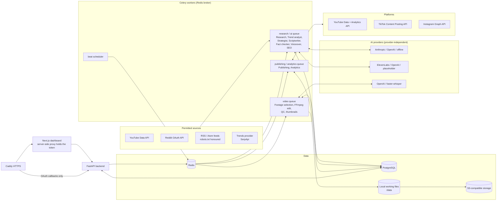

# System architecture

## Components

## Pipeline and stage records

Topic level (periodic): **research → topic scoring** (agents 1 and 2), then **strategy** (agent 3) turns the best topics into jobs.

Job level, each stage a recorded `StageRun` with status, attempt, error and output:

| # | Stage | Agent | Gate |
|---|-------|-------|------|
| 1 | fact_verification | Fact checker (topic mode) | topic has sources; news needs official/credible sources |
| 2 | script_generation | Scriptwriter | |
| 3 | script_validation | validator + Fact checker (script mode) | generic phrasing, length, disclaimers, sourced claims, confidence ≥ threshold |
| 4 | voiceover_generation | Voiceover | narration ≤ 60 s; budget |
| 5 | footage_selection | Video production | only rights-verified, unexpired, platform-licensed assets |
| 6 | video_editing | Video production | rights re-checked at render time; budget |
| 7 | quality_control | Quality control | technical QC must pass; publishability recorded separately |
| 8 | thumbnail_generation | Video production | |
| 9 | metadata_generation | SEO | misleading wording removed |
| 10 | publishing_queue | Publishing manager | idempotent enqueue per platform |

Then **distribution** (agent 9) and **analytics** (agent 10) run on their own schedules.

Failure handling (`engine/pipeline/orchestrator.py`):
- Safety gates (`AgentBlocked`), missing credentials (`NotConfigured`) and exhausted budgets (`BudgetExceeded`) **block** the job with a reason and are never retried automatically.
- Other failures are retried up to `processing.stage_retry_limit`, then the job is **failed**.
- A failed script validation supersedes the script so the next attempt rewrites it with the validator's feedback, within the same limit.
- Regeneration supersedes stage runs instead of deleting them, so history is kept.
- A job that has been sent to a platform cannot be regenerated (create a new job instead).

## Agents

All agents derive from `engine/agents/base.py::Agent`: a declared responsibility, a pydantic input and output model, a retry limit, and an `AgentRun` record per run.

| # | Agent | Module | Responsibility |
|---|-------|--------|----------------|
| 1 | Research | `agents/research.py` | fetch and store sources from configured connectors |
| 2 | Trend analyst | `agents/research.py` | cluster, classify, score, dedupe, write the topic report |
| 3 | Content strategist | `agents/strategist.py` | choose topics by score, category deficit, measured performance, urgency |
| 4 | Scriptwriter | `agents/scriptwriter.py` | hooks, scenes, captions, SFX, transitions, claims with sources |
| 5 | Fact checker | `agents/factcheck.py` | lexical support plus optional model judgement per claim |
| 6 | Voiceover | `agents/voiceover.py` | pronunciation fixes, TTS, processing, word timings |
| 7 | Video production | `agents/production.py` | footage ranking, render, exports, thumbnails, storage |
| 8 | SEO | `agents/seo.py` | per-platform titles, descriptions, hashtags, keywords |
| 9 | Publishing | `agents/distribution.py` | wraps the publishing manager |
| 10 | Analytics | `agents/distribution.py` | metrics collection and the weekly report |
| 11 | Quality control | `agents/quality.py` | technical QC plus content readiness |

No agent can change the operating mode, lift the publishing pause or exceed a budget: those are enforced in `settings_store`, `publishing/manager.py` and `costs.py`, outside the agents.

## Accuracy model

Classification is evidence-based (`research/classify.py`):
- **officially confirmed**: an attached source is on an official domain or a configured official channel;
- **credibly reported**: a reputable outlet without rumour wording, or two or more reputable outlets;
- **community theory**, **unverified rumour**, **false or debunked**: by wording and source mix.

Unconfirmed material can never be filed as news. Scripts for theories and rumours must carry a disclaimer. Titles lose "official/confirmed" unless the topic is officially confirmed.

## Video engine

`video/assemble.py` builds one FFmpeg filter graph:
- per-scene trim and cover crop to 1080×1920, with a slow alternating pan;
- `xfade` transitions;
- libass subtitles from `video/subtitles.py`: 3-word chunks, active-word highlight, keyword accent, scene headline, brand tag;
- narration, plus music ducked with `sidechaincompress`, plus SFX at scene starts;
- `loudnorm` to -14 LUFS / -1.5 dBTP;
- H.264 High, yuv420p, AAC 48 kHz, faststart.

Platform exports copy the video stream and re-encode audio to each profile (Instagram: 128 kbps). Footage audio is never used, because game audio can carry licensed music.

## Data model

See `backend/engine/models.py` and `backend/migrations/versions/0001_initial_schema.py`. Main tables:
- `topics`, `source_items`, `topic_sources`
- `content_jobs`, `stage_runs`, `scripts`, `voiceovers`, `renders`, `thumbnails`, `metadata_packages`
- `publications`, `platform_connections` (tokens encrypted), `metric_snapshots` (nullable metrics)
- `media_assets` (rights register), `cost_entries`, `agent_runs`, `audit_logs`, `reports`, `settings`
